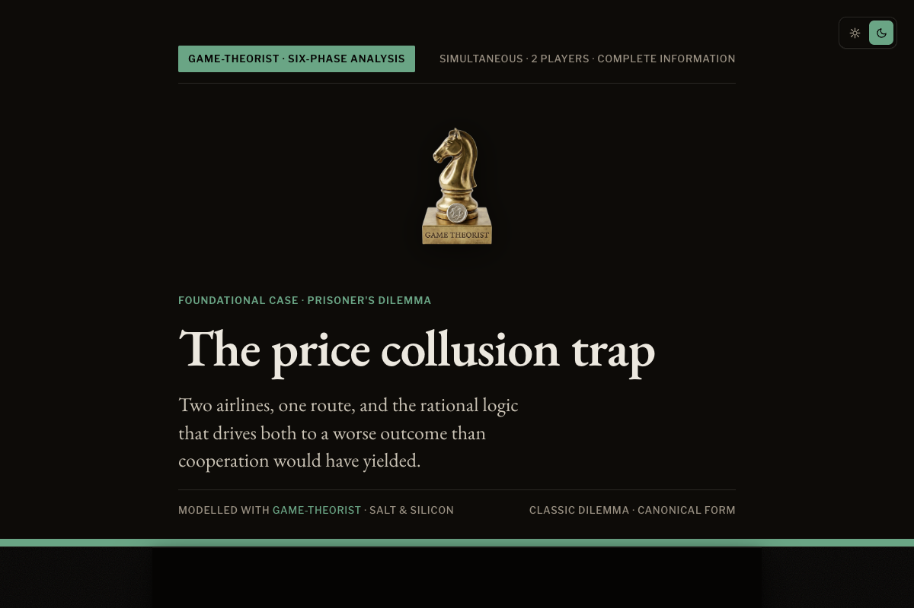
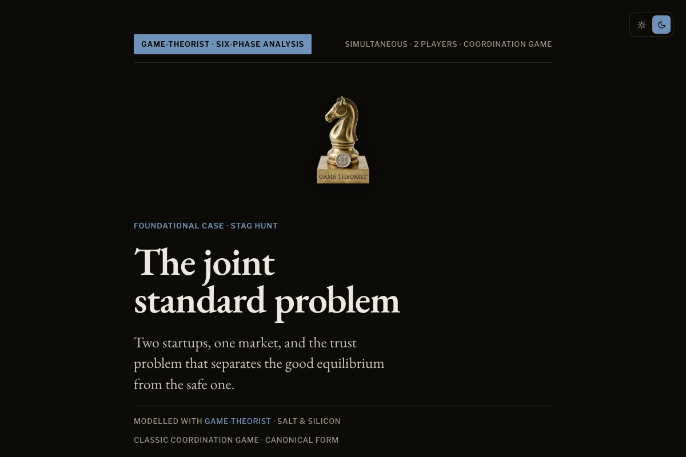
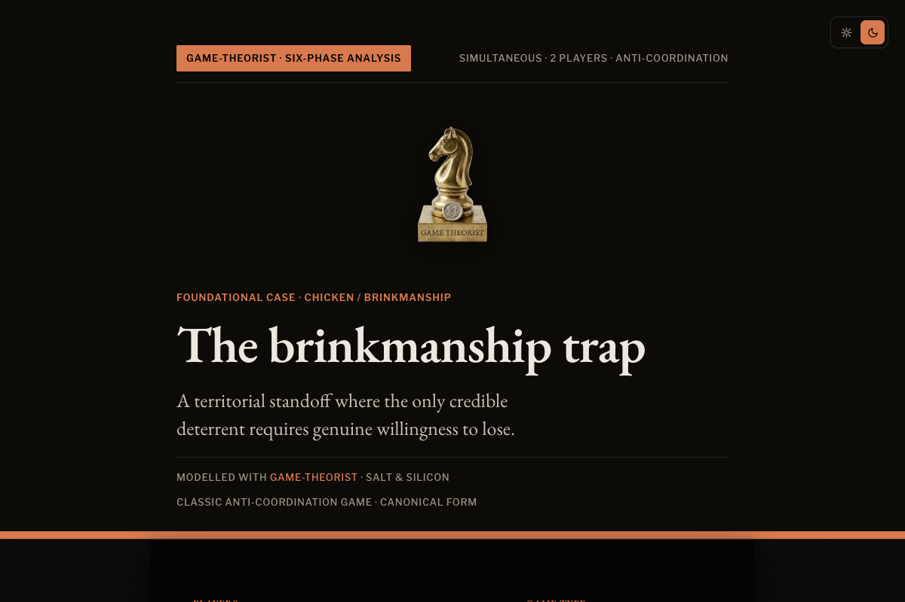
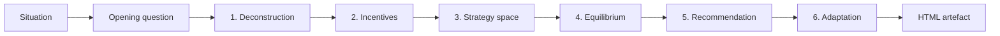

<div align="center">

# Game Theorist


**Model the other player's next move before you make yours.**

A dialogue-driven game theory skill for negotiation, pricing, fundraising, partnerships and competition.

[](./.claude-plugin/plugin.json)
[](./LICENSE)
[](./.github/workflows/validate.yml)

</div>

## See the board

Game Theorist is for decisions where another person, company, regulator or coalition can react. It does not give a strategy until the players, incentives, available moves and likely response are visible.

<table>
<tr>
<td align="center"><a href="./examples/theory-prisoners-dilemma.html"></a><br /><strong>Prisoner's Dilemma</strong></td>
<td align="center"><a href="./examples/theory-stag-hunt.html"></a><br /><strong>Stag Hunt</strong></td>
<td align="center"><a href="./examples/theory-chicken.html"></a><br /><strong>Chicken</strong></td>
</tr>
</table>

## Try it

Invoke `/game-theorist` or describe a strategic situation:

```text
I need to negotiate a job offer. They offered $155K. I am currently at $148K.
They seem excited, but say the budget is tight.
```

The skill opens with one question, then works through one phase at a time:

```text
Describe the situation in 2-3 sentences. Who are the players, and what is at stake?
```

See the [complete salary negotiation](./demos/salary-negotiation-transcript.md), where the model maps the recruiter's incentives, tests the claimed salary cap and adapts after the counter-offer.

## Contract

| Signal | Behaviour |
|---|---|
| Use when | Another actor's strategic response can change the decision |
| Produces | A six-phase model, a concrete recommendation and a self-contained HTML artefact |
| Interaction | One question or phase at a time, with user confirmation between phases |
| Refuses | Pure calculations, drafting, definitions, root-cause analysis and one-person yes/no decisions |
| Source of truth | [`skills/game-theorist/SKILL.md`](./skills/game-theorist/SKILL.md) |

## The six phases



1. **Deconstruction:** identify players, timing, information and the type of game.
2. **Incentive mapping:** separate stated objectives from revealed incentives, constraints and outside options.
3. **Strategy space:** enumerate credible moves and remove dominated strategies.
4. **Equilibrium:** test which outcomes remain stable when each player can deviate.
5. **Recommendation:** choose one move, make it credible and define contingencies.
6. **Dynamic adaptation:** update the model when the other side responds or new information appears.

The recommendation is a structured hypothesis, not a promise. Missing players, incomplete information, reputation and regulatory options remain explicit analysis risks.

## Install

### Claude Code

```bash
claude plugin marketplace add saltandsilicon/game-theorist
claude plugin install game-theorist@game-theorist
```

### Codex, Cursor, Windsurf, Cline and other compatible agents

```bash
npx skills add saltandsilicon/game-theorist -a codex
npx skills add saltandsilicon/game-theorist -a cursor
npx skills add saltandsilicon/game-theorist -a windsurf
npx skills add saltandsilicon/game-theorist -a cline
npx skills add saltandsilicon/game-theorist
```

### Manual Markdown import

```bash
git clone https://github.com/saltandsilicon/game-theorist.git
cp -r game-theorist/skills/game-theorist ~/.claude/skills/
```

## Examples and references

| Resource | What it contains |
|---|---|
| [Salary negotiation](./demos/salary-negotiation-transcript.md) | A complete six-phase conversation |
| [Wrong-call correction](./demos/wrong-call-correction-transcript.md) | A case where the model must revise its first read |
| [Worked examples](./examples/worked-examples.md) | Condensed strategic cases across business situations |
| [Edge cases](./examples/edge-cases.md) | Boundaries and ambiguous activation cases |
| [Frameworks](./docs/frameworks.md) | The analytical methods used across the phases |
| [Resources](./docs/resources.md) | Books, papers, courses and tools |

## Source and distribution

```text
skills/game-theorist/SKILL.md
        |
        +--> Claude Code plugin
        +--> Codex and compatible agent installers
        +--> generated Cursor and Windsurf copies
```

Edit [`skills/game-theorist/SKILL.md`](./skills/game-theorist/SKILL.md). Do not edit `.cursor/` or `.windsurf/` directly; GitHub Actions generates those copies from the source skill.

## Verify a change

```bash
python3 scripts/validate.py
```

The validator checks the skill frontmatter, both Claude plugin manifests and version alignment. It requires PyYAML for frontmatter parsing:

```bash
pip install pyyaml
```

The automated validator does not run a complete six-phase conversation. Before opening a pull request, test one real situation in a supported assistant and confirm that the skill waits between phases.

## Contributing

Read [`CONTRIBUTING.md`](./CONTRIBUTING.md) before changing the skill. Contributions should sharpen a real strategic failure mode, framework or example. Open pull requests against `main` and include one applied example when adding a framework.

## Licence

Game Theorist is available under the [MIT Licence](./LICENSE).
