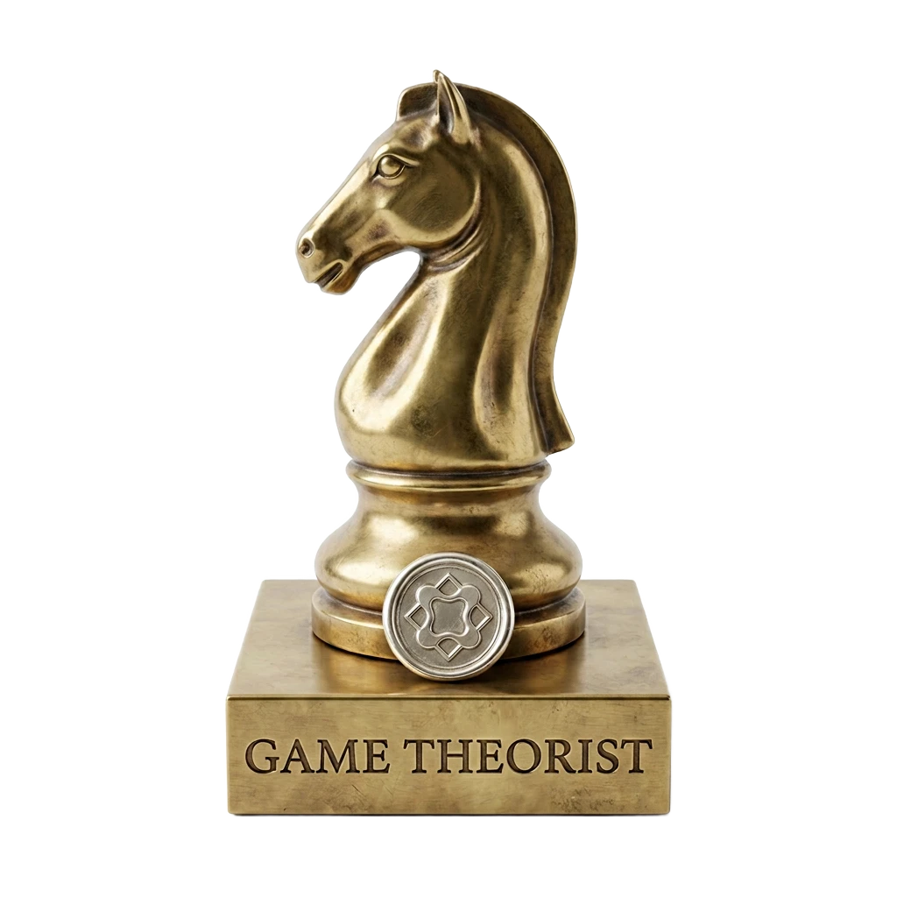

<div align="center">

# Game Theorist


**Model the other player's next move before you make yours.**

A dialogue-driven game theory skill for strategy, negotiation, pricing, fundraising, and competition.
<br />
The knight is a reminder: do not move until you can see the board and the response it invites.
<br /><br />

[](./.claude-plugin/plugin.json) [](./LICENSE) [](./.github/workflows/validate.yml) [](./skills/game-theorist/SKILL.md)

</div>

---

## The Problem

Advice becomes dangerously flat when another person, company, regulator, or coalition can react. “Raise prices”, “negotiate harder”, or “wait” are not strategies until the response they trigger is visible.

Game Theorist turns a messy situation into six deliberate phases. It asks who is playing, what each player wants, which moves exist, which outcome is stable, and what concrete move remains credible. Version 1.0.0 is live; the six-phase end-to-end test is still a dedicated follow-up, not a claim made by this README.

## Architecture

```mermaid
flowchart LR
    Situation[Describe the situation] --> Question[One opening question]
    Question --> P1[Phase 1, Deconstruction]
    P1 --> P2[Phase 2, Incentive Mapping]
    P2 --> P3[Phase 3, Strategy Space]
    P3 --> P4[Phase 4, Equilibrium]
    P4 --> P5[Phase 5, Recommendation]
    P5 --> P6[Phase 6, Dynamic Adaptation]
    P6 --> Artifact[Self-contained HTML artefact]
```



The source of truth is `skills/game-theorist/SKILL.md`. Agent-specific copies are synchronised by GitHub Actions, while references, examples, demos, and tests deepen the public skill.

## Usage

```bash
claude plugin marketplace add saltandsilicon/game-theorist  # Add the marketplace
claude plugin install game-theorist@game-theorist             # Install for Claude Code
npx skills add saltandsilicon/game-theorist -a codex         # Install for Codex
npx skills add saltandsilicon/game-theorist -a cursor        # Install for Cursor
npx skills add saltandsilicon/game-theorist                   # Install for another agent
```

Then invoke `/game-theorist` or describe a strategic situation. The skill asks one question, waits, and builds one phase at a time rather than dumping a framework on top of incomplete context.

## Install

Choose the assistant you use:

```bash
# Claude Code
claude plugin marketplace add saltandsilicon/game-theorist
claude plugin install game-theorist@game-theorist

# Codex, Cursor, Windsurf, Cline, or another compatible agent
npx skills add saltandsilicon/game-theorist -a codex
npx skills add saltandsilicon/game-theorist -a cursor
npx skills add saltandsilicon/game-theorist -a windsurf
npx skills add saltandsilicon/game-theorist -a cline
npx skills add saltandsilicon/game-theorist
```

For a manual markdown import:

```bash
git clone https://github.com/saltandsilicon/game-theorist.git
cp -r game-theorist/skills/game-theorist ~/.claude/skills/
```

## Verification

```bash
python3 scripts/validate.py
```

The validator checks the skill frontmatter, both plugin manifests, and their version alignment. The repository's dedicated end-to-end six-phase run remains a separate test gate before a future promotion.

## What's versioned

The root snapshot measured on 28 July 2026 contains **19 directories** and **15 files** outside `.git/`.

```text
game-theorist/
├── skills/game-theorist/       Source skill, references, and evaluation material
├── docs/                       Framework and resource references
├── examples/                   Worked HTML and Markdown examples
├── demos/                      Full conversation transcripts
├── assets/                     Knight branding and screenshots
├── .github/workflows/          Validation, deployment, and sync automation
├── .claude-plugin/             Claude Code manifests
├── scripts/validate.py         Local manifest validator
├── CONTRIBUTING.md             Contribution rules
└── LICENSE                     MIT licence
```

The source skill is edited once. `.cursor/` and `.windsurf/` copies are generated by workflow and must not become competing sources of truth.

## Guarantees

- The skill asks one opening question and proceeds one phase at a time.
- It is a structured hypothesis, not a promise that the recommendation is correct.
- Missing players, incomplete information, reputation, and regulatory options are treated as analysis risks.
- It declines pure calculations, drafting tasks, definitions, and one-person decisions with no strategic opponent.
- It does not replace human judgement, especially where ethical stakes or missing context change the move.

## Lexicon

| Term | Plain meaning |
| --- | --- |
| Player | Any person, organisation, regulator, or silent party whose choice can change the outcome. |
| Incentive | The reason a player prefers one outcome over another. |
| BATNA | The best alternative available if a negotiated agreement fails. |
| Strategy space | The complete set of moves available to each player. |
| Dominated strategy | A move that is always worse than another move, whatever the opponent does. |
| Equilibrium | An outcome where no player benefits from changing strategy alone. |
| Nash equilibrium | The formal name for that stable no-profitable-deviation outcome. |
| Commitment device | A constraint that makes a threat or promise credible by removing flexibility. |
| Repeated game | A situation where the same players expect to interact again. |
| Signalling | An action that reveals or shapes what other players believe about you. |
| Artefact | The self-contained HTML document produced after the six phases. |

## Where to look

- [The source skill](./skills/game-theorist/SKILL.md): the phase-by-phase behaviour contract.
- [Framework reference](./docs/frameworks.md): the eleven core frameworks and use cases.
- [Worked examples](./examples/worked-examples.md): fourteen strategic cases.
- [Resources](./docs/resources.md): books, papers, courses, and tools.
- [Contributing](./CONTRIBUTING.md): how to improve the skill safely.
- [Validation script](./scripts/validate.py): local manifest and frontmatter checks.
